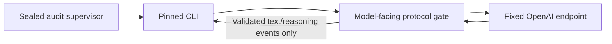

# ADR 0011 — Model-facing zero-tool protocol gate

Status: PROPOSED. Owner decision required before adopting this architecture.
Existing automatic-merge authorization remains conditional; this proposal does
not activate reviews, merge, a third real-model trial or authentication recovery.

## Newly established problem

The audit-only runtime upgrade and exact-record status reconciliation succeeded.
The original trial is preserved. A separately permitted synthetic diagnostic then
stopped at upstream_response, policy, HTTP200. The original response media type
was not recorded; this is not evidence of a successful inference or review.

Installed CLI0.166.0 uses Responses Lite for the selected gpt-6.1-sol model. The
sealed public catalog declares use_responses_lite=true and tool_mode=code_mode_only.
Same-version client source sends x-openai-internal-codex-responses-lite=true;
the relay omitted it. This is an established interoperability defect, although
it does not conclusively explain the unrecorded response media type.

More seriously, Lite places tool declarations inside input additional_tools,
not top-level tools. The old gate checked only the latter. Actual native CLI
tests against a local synthetic SSE server showed three embedded namespaces:
functions, clock and collaboration. Explicit code_mode/code_mode_only/multi_agent
feature disabling did not remove them for this model. A diagnostic-only copy of
the catalog with tool_mode=direct still advertised tools, including apply_patch
and view_image. No deployed catalog or real credential was changed by these tests;
there was no external inference. Native local schema roundtrips passed, which
demonstrates why they alone did not establish zero-tool behavior.

The previous zero_tools_verified preparation receipts are therefore insufficient
and must not satisfy activation. Existing OS/job/config restrictions remain,
but their existence does not establish a tool-free model execution boundary.
No App review/check or merge has been published. Keep the original trial and
diagnostic intents held; do not retry/reset them or weaken CI/acceptance.

Primary source: [Responses Lite tests](https://github.com/openai/codex/blob/rust-v0.166.0/codex-rs/core/tests/suite/responses_lite.rs),
[client header construction](https://github.com/openai/codex/blob/rust-v0.166.0/codex-rs/core/src/client.rs),
and [tool registry construction](https://github.com/openai/codex/blob/rust-v0.166.0/codex-rs/core/src/tools/spec_plan.rs).

## Recommended design

Keep the same audit identity, official pinned CLI, own encrypted login, model,
provider and fixed HTTPS destination. Extend the existing relay into an explicitly
model-facing zero-tool protocol gate. Do not claim the native registry is empty.

Before forwarding a request, parse bounded duplicate-free JSON, require the
fixed model/fresh source and no prior tool history, and remove all tool
declarations from both standard and Lite locations. Preserve source/spec/QA
packet and instructions exactly. Verify the resulting model-facing executable
tool inventory is zero. Handle authoritative tool-metadata locations explicitly;
do not assume removing one field suffices. Forward only the fixed validated Lite
protocol marker, in addition to already approved headers/destination. Credentials
stay transient in trusted CLI/relay memory and never reach model input or logs.

Pin a closed request schema for the exact CLI/standard/Lite versions: allowlist
top-level fields, input item types, nested content shapes and authoritative
metadata fields. Reject unknown fields/types or capability-bearing semantics,
nonstandard JSON constants, duplicate keys and tool-history variants. A parser
upgrade must fail closed until reviewed. Differential tests must prove that the
transformation changes only approved tool-definition/authoritative-tool-metadata
locations and preserves every source/spec/QA/instruction value exactly.

Before writing any provider bytes to the CLI, buffer each complete bounded SSE
event, parse strict JSON and reject unknown event/output types. Allow only the
minimal text/message/reasoning events needed by the pinned parser. Reject every
function/custom/MCP/browser/computer/code/tool call, including partial call events
and calls inside terminal response objects. Do not forward an initial tool item
while waiting for its completion. Reject malformed, oversized, duplicate-field,
truncated or out-of-order streams. Never convert an error/JSON/HTML response into
a success or manufacture model findings. Preserve strict terminal response,
task binding and authoritative local review schema checks.

The native registry remains potentially capable; the gate is a mandatory new
security boundary. Fail closed if unavailable, changed or unproven. Preserve
single-process job containment, empty workspace, sealed config/runtime, private
state, App/operator credential denial, no tools/MCP/apps delegation through model
output, deadlines/cancellation and exclusive durable intents. No fallback to the
old top-level-only receipt. Safe diagnostics may expose finite media categories
and HTTP status, never raw headers, provider bodies, tokens or model reasoning.

ADR0009's empty-tool-surface requirement must be explicitly refined by the owner:
this design provides an empty model-facing surface plus enforced rejection before
native execution; it does not provide an empty native registry. If native registry
absence is mandatory, select the dedicated-executor alternative. Do not silently
reinterpret a frozen acceptance condition or claim either boundary proven merely
because the owner selected the design. Product acceptance is unchanged.

## Required evidence before any real-model verification

Prove actual native outgoing Lite/standard requests have zero model-facing tools.
With malicious local SSE, test every tool-call family, fragmented frames,
terminal-object smuggling and forged ordering. Prove no tool event reaches the
CLI, no marker file changes, no child/subagent/second inference starts and all
processes terminate within the same deadline. Also prove valid bounded text-only
schema completion, malformed/failure holds, storage bounds, peer denial and no
credential/raw-response persistence. Independently audit implementation and exact
deployed artifact. A passing synthetic test does not certify live provider behavior.

Preserve both prior real-model attempts and their permits. Propose a separately
hash-bound final validation with a cumulative maximum of three real inference
attempts including the two already consumed. Do not reset counts across artifact
updates or treat a changed nonce as retry permission. Unknown completion remains
held. Authentication recovery, if necessary, is a separate exact-record permit;
no token/password/key reset or implicit re-enrolment.

## Alternative

Build a dedicated tool-free executor without the CLI tool registry, using a
supported, separately audited model/authentication integration. This creates a
larger trusted implementation and credential-handling change. Do not silently
switch providers, models, paid API keys or reuse/export the operator's login.

This proposal changes a material security boundary. AGENTS.md says: "If a decision
materially affects confidentiality, security or scope, ask first." The owner's
instruction14 also forbids automatically finalizing a major architecture change.
Owner approval here selects design/implementation scope; actual deployment and
activation still require concrete audited packages and live gates.
