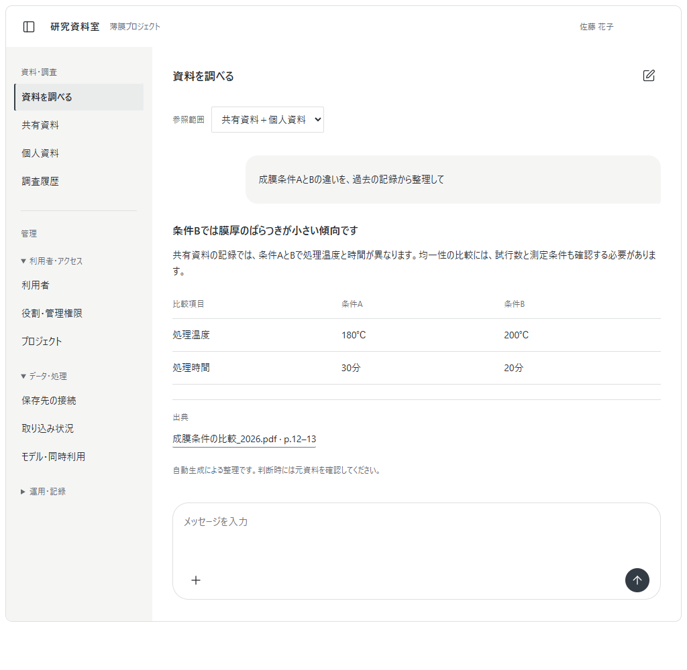

# UI実装基準：研究資料室

記録日：2026-10-29  
状態：ユーザーが実装時の基準として指定した画面。今後の実装・レビューで参照する。

## 基準画面

基準は、この文書と同日に提示した最終改訂デモ。初期のカード中心のデモや、文字付き開閉ボタンの画面には戻さない。画面内の資料名、回答、数値、利用者はサンプルであり、製品要件ではない。

## 見た目と操作の決定事項

| 対象 | 実装する形 |
|---|---|
| 全体 | ChatGPTに近い、使い慣れたチャットの配置・操作。中立的な配色と控えめな装飾 |
| サイドバー | 左配置。開閉はパネル型SVGアイコン。閉じた後も同じ場所から再表示可能 |
| 開閉動作 | 本文幅に連動する短いアニメーション。初期値220ms。動きを減らす設定では無効 |
| 管理メニュー | 利用者・アクセス、データ・処理、運用・記録の折りたたみグループ。権限に応じて表示 |
| 会話 | 中央の読みやすい幅。利用者の発言は右寄りの淡い背景、回答は本文として表示 |
| 入力欄 | 会話の下部に角丸の入力欄。プレースホルダーは「メッセージを入力」 |
| 添付 | 左下のプラスSVGアイコン。ファイル選択とドラッグ＆ドロップの両方に対応 |
| 添付済み資料 | ファイル名と取り外しアイコンを入力欄内に表示。実装時は処理状態も必要に応じて表示 |
| 送信 | 右下の上矢印SVGアイコン |
| 新規会話 | 編集・新規作成を表すSVGアイコン |
| 説明表示 | 「ここへドラッグ＆ドロップ」「メニューを閉じる」などの常設案内文は置かない |
| 入力欄の装飾 | 発光、色付き強調枠、ドラッグ時の点線・背景変化を付けない |
| 必要な情報 | 参照範囲、出典、自動生成の位置づけ、処理失敗など判断に必要な情報を残す |

## React実装への対応

既存のReact／TypeScript構成案を前提とする。アイコンは同一のSVGアイコンライブラリで統一する。Lucide Reactを採用する場合の対応は `PanelLeft`、`Plus`、`ArrowUp`、`SquarePen`、`X`。文字や絵文字で代用しない。実際のパッケージ版とライセンスは依存関係を決める際に確認する。

アイコンボタンには読み上げ名を設定し、ホバー・フォーカス時に短いツールチップを出す。サイドバー開閉には `aria-expanded` と `aria-controls` を設定し、閉じた内部の項目にはフォーカスが入らないようにする。キーボード操作のボタンのフォーカス表示は残す。入力欄を光らせる演出にはしない。

公開先は「ロール × 適用範囲 × 操作」で設定する。共有資料、個人資料、会話の添付を区別し、添付から共有への自動公開は行わない。権限や保存期間の詳細は `ui-and-multiuser-design.md` を参照する。

## 完了確認

- 基準画像と見比べ、配置・文字量・アイコン・入力欄の見た目が意図せず変わっていない。
- サイドバーを開閉しても、再表示操作を見失わない。
- ファイル選択とドロップが同じ添付処理へ入り、質問の下書きが消えない。
- 添付を個別に外せる。実装時は、未解析・失敗・参照可能の状態を区別する。
- ドラッグ、クリック、入力中に不要な枠の発光や案内文を追加しない。
- アイコンのみの操作をキーボードと読み上げでも識別できる。
- 狭い画面や長いファイル名でも本文・操作がはみ出さない。
- 管理メニューの表示だけでなく、サーバーでも操作権限を確認する。

実装時に見た目を変更する必要が出た場合は、この基準との差分と理由を提示する。未決定のモデル・接続方式・処理性能を、画面が確定したことだけを理由に確定扱いにしない。
