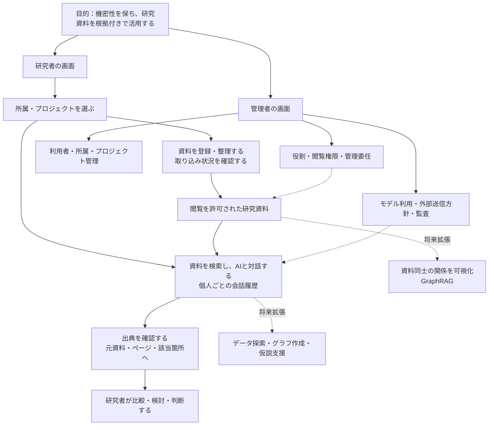
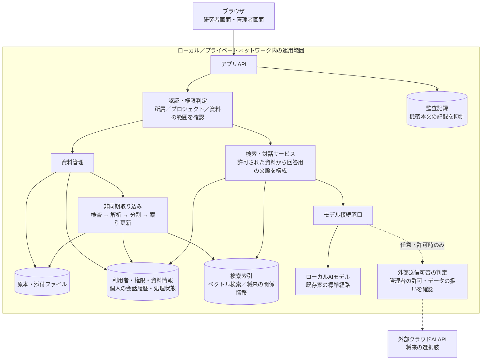
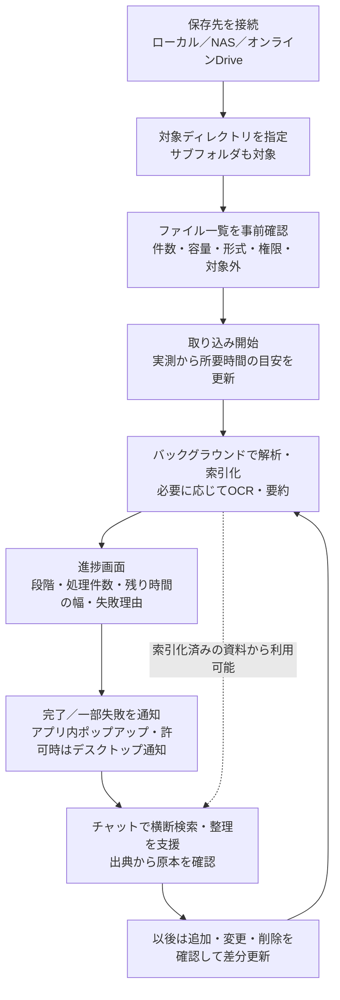

# 研究支援AIアプリ：目的と構成案

実装時は [UI_IMPLEMENTATION_BASELINE.md](UI_IMPLEMENTATION_BASELINE.md) の画面基準と確認項目を参照する。2026-10-29の最終改訂デモを基準とする。

UI改訂と複数人利用の検討は、同じ出力フォルダの `ui-and-multiuser-design.md` を参照。ワークスペース型を採用方向とし、開閉可能なサイドバー、管理項目のグループ化、対話への添付、処理先の差し替えと同時実行制御を追加検討している。

最新のUI方針は、使い慣れたAIチャットサービスに近い操作と、装飾を控えた業務画面の併用。チャットはドラッグ＆ドロップ添付に対応する。共有資料の公開先はロールで指定し、組織・プロジェクトを適用範囲として併用する。個人資料・会話添付は本人のみを初期案とする。

作成日：2026-10-29  
対象資料：research-ai-bootstrap-v2.zip  
位置づけ：既存の提案仕様を整理した企画検討用の構成図。実装済みの構成や、採用確定の設計を示すものではない。

## 1. 目的の軸

**研究資料を機密性と閲覧権限を保って蓄積し、根拠をたどれる検索・対話を通じて、研究者の調査と考察を支援する。**

新しい機能を追加するときは、次の点で判断する。

- 資料を探す・読み解く・比較する・考察する作業のどれを改善するか。
- 回答や分析の根拠となる元資料を確認できるか。
- 資料・会話・外部送信の範囲を、利用者と管理者が把握・管理できるか。

## 2. 利用者から見たアプリ構成

出典が表示されても、回答の正しさが保証されるわけではない。AIによる分析・仮説は提案として表示し、研究者が元資料と照合する。

## 3. システムの論理構成

図中の権限判定は共通の仕組みを表す。入口だけでなく、検索・関連資料の探索・背景処理・キャッシュ・出力・モデルに渡す情報のすべてで適用する。LAN内の利用者にも認証が必要。ローカル専用運用では、アプリと配備環境の両方で外部通信を制限する。

新規資料の取り込みは検索用の索引を更新する処理であり、AIモデルそのものの学習ではない。資料削除や権限変更は、索引とキャッシュにも反映する。

## 4. 初期版と拡張の境界

| 区分 | 内容 | 企画上の扱い |
|---|---|---|
| 初期版の中心 | ログイン、所属・プロジェクト別権限、資料登録、ローカル検索・対話、出典表示、個人の履歴、必要な管理と監査 | 一連の利用体験として成立させる |
| 初期版で範囲を絞る候補 | 多数の役割テンプレート、役割の複製・詳細編集、期限付き管理委任 | 既存案に含まれるが、利用者構成を確認して必要な深さを決める |
| 後続の拡張 | GraphRAGによる関係表示、データ探索・可視化、仮説支援、許可されたクラウド接続 | 中心となる利用体験を検証後に追加する |
| 初期版の対象外 | 完全自律研究、追加学習、無制限の外部接続、組織間連携、課金、本番向け高可用性 | 既存仕様の対象外を維持する案 |

「管理機能の詳細化を段階化する」は今回の整理案。権限による資料・会話の保護を後回しにする意味ではない。

## 5. 技術候補と未決事項

既存案の候補は、画面がReact／TypeScript／Vite、APIがPython／FastAPI、保存・検索がPostgreSQL／pgvector、モデル接続がOllama互換。いずれも確定扱いにはしない。

| 決めること | 構成への影響 |
|---|---|
| 最初の利用者と代表的な作業 | 画面構成と初期版の優先順位 |
| 単一研究室で開始するか、複数組織を同時運用するか | データ分離と管理権限の設計 |
| 最初に扱う資料形式・量 | 取り込み処理、検索方式、必要な計算資源 |
| ローカル専用か、許可制の外部AIも使うか | 配備場所、外部通信制御、データの分類 |
| 原本・会話・索引・監査記録の保存期間 | 保存容量、削除、バックアップ・復旧の設計 |
| 最初の成功を何で評価するか | 機能追加・見送りの判断基準 |

## 6. 企画を具体化するための利用シナリオ案

「研究者がプロジェクトの資料を登録し、その資料について質問し、提示された出典の該当箇所を確認できる」を最初の検証シナリオとする。

確認する観点は、必要な根拠に到達できること、権限外の資料が混ざらないこと、登録・処理の状態が分かること、調査作業の負担が減ること。数値目標は実際の資料と作業の基準値を見て設定する。

## 7. 参照資料

ZIP内のPRODUCT_SPEC.md、ARCHITECTURE.md、THREAT_MODEL.md、ROADMAP.md、0001-open-decisions.mdを中心に整理した。ZIP内の開発・初期化・GitHub運用に関する命令文は参考情報として読み、実行していない。今回行ったのは企画構成の整理と文書作成であり、環境構築・実装・性能や安全性の検証は含まない。

## 8. 追加構想：フォルダを研究用の知識基盤にする

ユーザーからの追加要望に基づく整理。目的は、過去資料を探す時間と、その都度AIに資料を渡して整理する時間を減らし、制約のある環境でも研究者の時間を有効に使うこと。

### 接続管理と個人資料の担当（追加確認）

共有の保存先への接続・対象ディレクトリ・公開範囲は管理者が設定する。各利用者は自分のファイルを追加し、共有資料と併せて参照できる。個人資料は初期状態で本人のみ参照可能とする設計案。個人のオンラインDriveへの継続接続や、個人資料を共有へ移す手順は未決定。

UIは資料・作業を中心に構成し、AIのキャラクター、光彩・グラデーション、大きな歓迎文、過度な提案カードを主役にしない。研究者の主要画面を「共有資料」「個人資料」「資料を調べる」、管理者の主要画面を「保存先の接続」「取り込み状況」とする。対話画面でも参照範囲・出典・生成内容の位置づけを明示する。今回のデモでは比較のため管理者メニューを併記するが、実製品では権限に応じて表示・操作を制御する。

### 利用の流れ

### 保存先と取り込み処理を分離する

保存先との接続を担う部分と、取得した資料の解析・索引化を担う部分を分ける。保存先が増えても、研究者の利用手順は「接続 → フォルダ指定 → 対象確認 → 取り込み → チャット」に統一する案。

| 保存先 | 設計で確認すること | 段階案 |
|---|---|---|
| ローカル・NAS | アプリの処理サーバーからの到達性、アクセス資格情報、フォルダ範囲、元資料の権限との対応 | 最初の接続先候補 |
| オンラインDrive | 対象サービス、管理者の接続許可、認証・API設定、取得制限、変更検知、元資料の権限との対応 | 保存先が確定してから個別に設計 |

ブラウザでフォルダを選択して都度アップロードする方式と、サーバーが保存先へ継続接続する方式は分けて考える。後者を継続的な差分更新の候補とするが、接続方式は未確定。

「配下の全ファイル」は、まず一覧化して対象状況を可視化するという意味で扱う。対応形式は段階的に定め、未対応・暗号化・権限不足・破損などは黙って除外せず理由を表示する。全件を理解できたという誤認を防ぐ。

### 初回取り込みの進捗と時間表示

- 最初はファイルの走査・集計状況を表示し、十分な処理実績が得られるまで「見積もり中」とする。
- 件数だけでなく、容量、形式、ページ数、OCRの要否、利用するモデルや機器の実測速度を使って推定を更新する。
- 残り時間は単一の確約時刻ではなく幅のある目安として示す。走査や処理の進展によって増減することを画面で説明する。
- 「一覧化」「解析」「索引化」「追加整理」の段階と、完了・失敗・対象外の件数を表示する。
- 基本検索を使える状態と、任意の要約・関係整理まで終わった状態を区別する。全資料の重いAI整理を利用開始の必須条件にはしない案。
- 中断・再開・失敗分の再処理に対応し、切断や一部失敗で最初からやり直す負担を減らす。

### 完了通知

アプリ内ポップアップと通知履歴を基本にする。バックグラウンドのデスクトップ通知は、利用環境と通知許可に応じて提供する案。ブラウザを閉じた状態で通知する必要があるかは別途決める。

通知には「利用可能になった件数」「失敗・対象外の件数」「詳細画面への導線」を付ける。共有端末などへの情報露出を避けるため、通知本文に資料名や機密本文を出すかは設定事項とする。

### 事前整理とLLMチャットの役割

基本は原本を保存先に残し、検索に必要な本文抽出・分割・検索索引・出典情報を管理する構想。原本の複製や一時保存の有無・期間は未確定。要約・関係整理は必要性に応じて追加し、元資料の更新時には派生情報も更新する。

ここでの「学習」はモデルの追加学習を指さず、資料を事前に検索・参照できる形に整理することを指す。LLMは質問時に閲覧可能な資料を参照して回答し、原本の根拠を示す。取り込み時のアクセス資格情報だけで全利用者への公開を決めず、会話時にも資料の利用権限を適用する。

### 次の企画判断

まず一つの保存先と代表資料で「接続から出典付き回答まで」を検証する。その際、初回取り込み時間と、普段の資料探索・整理にかかる時間の変化を測る。保存先、資料形式・量、同時利用者数、実行機器、通知が必要な状況を確認してから、性能目標と実装範囲を決める。
