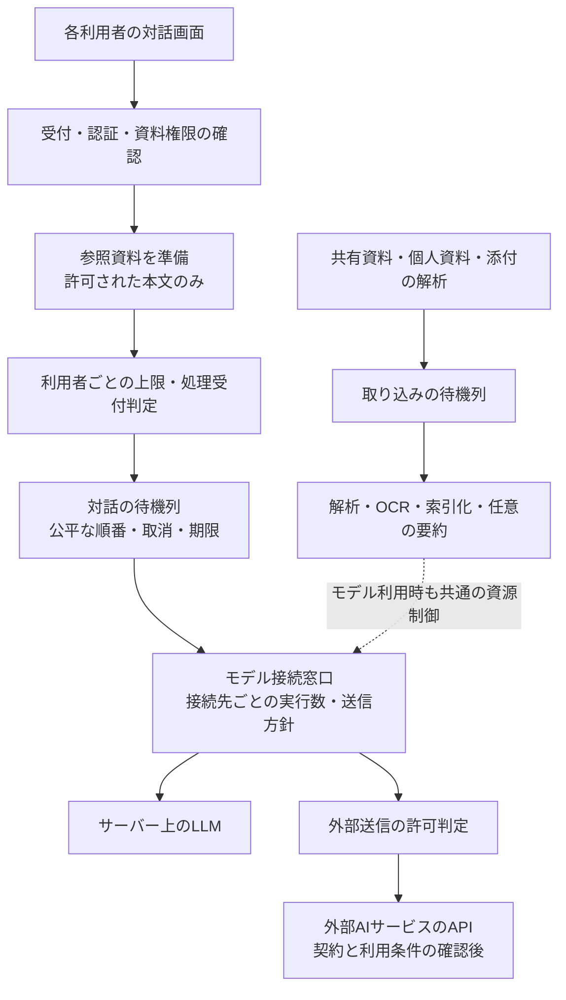

# 研究資料室：UI・対話・複数人利用の設計指針

実装時の画面基準は [UI_IMPLEMENTATION_BASELINE.md](UI_IMPLEMENTATION_BASELINE.md) と同梱の基準画像を参照する。以下の検討履歴と食い違う場合、最新のユーザー指示を反映した基準文書を優先する。

更新日：2026-10-29  
状態：企画・実装参照用。デモは操作と見た目の検討用で、性能・接続・権限制御を実装したものではない。

## 最新の方針：使い慣れたAIサービスに近いチャット

最新の具体化：ドラッグ＆ドロップの常設案内文、開閉ボタンの文字、入力欄の操作説明、添付のデモボタンを表示しない。サイドバーは提示画像に近いパネル型SVGアイコン、添付はプラス、送信は上矢印、新規会話は編集アイコンを使う。React実装では同じアイコンライブラリのコンポーネントを利用し、文字・絵文字や独自図形で代用しない。デモはLucideのSVGを利用する。

入力欄に発光、色付きの強調枠、ドラッグ時の点線や背景変化を付けない。アイコンボタンには読み上げ名と必要時だけ表示されるツールチップを持たせる。キーボード操作時のボタンのフォーカス表示は維持する。入力欄のプレースホルダーは短くする。出典と生成内容の位置づけ、失敗時の通知など判断に必要な情報は残す。この具体化を、下記に残る「ドラッグ中は受け入れ領域を明示」という旧案より優先する。

ユーザーの追加指示により、チャットのUI・操作は一般的なAIチャットサービスにできる限り近づける。以前の「AIっぽく見せない」は、定型的な装飾や不要な演出を減らす意図として整理し直す。使い慣れたチャット操作まで避ける方針にはしない。この追記を以前の見た目の指針より優先する。

- 会話本文を中央に配置し、利用者の発言と回答を判別できる構成にする。
- 下部の入力欄、添付ボタン、送信ボタン、新しいチャット、履歴への導線を用意する。
- 入力欄にファイルをドラッグ＆ドロップして添付できる。常設の案内文やドラッグ時の強調枠は表示せず、添付後に名前・状態・取り外し操作を表示する。
- ファイル選択ボタンも同じ添付処理へつなぎ、キーボードやタッチで利用できるようにする。日本語入力中の誤送信を防ぐキー操作は実装時に検討する。
- 本文の読み込み、アップロード、解析を終えたことと、単に添付欄へ追加したことを区別する。
- デモではドロップと選択のどちらもファイル名だけを取得し、本文の読み取りや送信はしない。

### 公開先はロールでまとめて指定する

ロールによる公開先指定を優先する。プロジェクトは資料の整理・範囲指定として併用できる。例として「薄膜プロジェクトの研究者に閲覧・チャット参照を許可」と設定し、利用者を一人ずつ指定する手間を減らす。

| 設定 | 意味 | 例 |
|---|---|---|
| ロール | どの役割の利用者に許可するか | 研究者・閲覧者 |
| 範囲 | その役割が有効な組織・プロジェクトはどこか | 薄膜プロジェクト |
| 操作 | 資料に対して何を許可するか | 閲覧・チャット参照 |

同名の「研究者」であっても別プロジェクトの資料まで自動的に公開しない。公開設定の保存前に「対象資料・ロール・範囲・操作」を文章で表示する。所属変更・ロール変更・資料移動時にも実効権限を再評価し、索引・出典・要約・キャッシュ・モデルへ渡す内容に適用する。

個人資料と会話の添付は、ロールを持つという理由だけでは他人に公開しない。資料公開の権限と、利用者管理・保存先設定などの管理権限も区別する。

ロールの兼任、明示的な拒否との優先順位、元保存先の権限との対応、共有資料から生成した会話を後から開く際の権限再確認は未確定。実装前に決める。システム管理者に個人会話の閲覧権限が自動付与されるとは扱わない。

## ユーザーが示した方針

- 左サイドバーを持つワークスペース型を採用方向とする。
- サイドバーは閉じられ、開閉にアニメーションを付ける。
- 役割・管理権限など管理項目の増加に耐えるナビゲーションにする。
- 使いやすく管理しやすい業務用UIとし、チャットはChatGPTに近い配置と操作にする。不要な案内文と装飾を避ける。
- 共有保存先の接続は管理者が担当する。利用者は個人の資料も追加・参照できる。
- チャットにファイルを添付できる。
- LLMの処理先は未確定。サーバー上のLLMと外部サービスの選択肢を残し、複数人の同時利用を前提に設計する。

以下の具体的な寸法、優先度、保存ルールは今回の提案であり、確定要件と区別する。

## 見た目と操作の原則

### 主役は資料と作業

資料一覧、見出し、原文、比較表、処理状態を中心に画面を組み立てる。対話は調査するための一つの画面として提供する。全画面をチャット開始の入口にしない。

既存デモについてユーザーは「妙にAIっぽい」と感じている。どの要素が原因かは未特定のため、以下を改善仮説として扱い、次の画面確認で評価する。

- グラデーション、発光、装飾的なオーブ、きらめき、マスコットを使用しない。
- 大きな歓迎文や質問例カードを画面の中心に置かない。
- 情報をすべて角丸カードや色付きの丸いラベルに包まない。
- 大きな余白の連続、装飾的な指標カード、不要なアイコンを避ける。
- 中立的な配色、細い区切り、読みやすい密度、左揃えの表と文書の構造を優先する。
- 出典・自動生成の表示は残す。見た目を控えめにすることと、AI生成であることを隠すことを混同しない。
- 主な操作に「資料を調べる」「ファイルを添付」「出典を見る」など、作業内容が伝わる名称を使う。

### サイドバー

上部の開閉ボタンはサイドバーを閉じても残す。開閉に伴って本文の幅が変わる。初期提案は約220msの幅・位置の変化とし、動きを減らす設定ではアニメーションを無効にする。

閉じた項目はキーボード操作・読み上げの対象から外す。開閉状態を画面移動後も維持する。狭い画面ではメニューを本文の上へ展開するなど、本文を細く圧迫しない構成を選ぶ。

項目はタブとして横一列に増やさず、折りたたみ可能なグループで整理する。

| グループ | 主な項目 |
|---|---|
| 資料・調査 | 資料を調べる、共有資料、個人資料、調査履歴 |
| 管理：利用者・アクセス | 利用者、役割・管理権限、プロジェクト |
| 管理：データ・処理 | 保存先の接続、取り込み状況、モデル・同時利用 |
| 管理：運用・記録 | 実行待ち・負荷、操作記録、保存・削除方針 |

グループの追加・名称変更は実際の管理作業を基に行う。実製品では有効な権限と担当範囲に応じて項目・操作を表示し、サーバー側でも権限を判定する。デモは比較のため管理者として表示している。

## チャットへの添付

共有資料・個人資料・会話の添付を区別する。添付は初期案として会話内で参照し、共有資料への自動公開や、個人資料ライブラリへの自動登録を行わない。ライブラリへ登録する場合は別操作として明示する。

実装する状態：ファイル選択、添付からの取り外し、アップロード中、検査・解析中、参照可能、失敗、取消。未解析のまま回答するときは、その資料を参照できていないことを示す。ファイル名やアップロード完了だけで内容を読んだと表示しない。

対応形式・容量・件数の上限を表示し、検査・安全な解析・資料単位の権限・削除反映は通常の取り込みと共通化する。添付内の命令文は資料の内容として扱い、システムや管理者の指示として実行しない。

会話・添付の所有者、プロジェクト範囲、保存期間、削除と再開、他人への共有可否はデータモデルで明示する。具体的な保持期間と共有手順は未決定。デモではファイル名のみを表示し、本文を取得・送信しない。

## 処理先を固定しない構成

外部サービスのサブスクリプションが、このアプリからのAPI接続を含むとは現時点で扱わない。サービスと契約が決まった段階で、利用方法・同時利用条件・API枠・データの扱いを一次情報で確認する。今回の検討ではサービスや契約を選定していない。

ローカルの処理能力が不足しても、無断で外部へ切り替えない。機密資料の許可範囲は処理先が変わっても維持する。

## 同時利用に耐えるための設計案

- 接続人数、同時に処理する質問数、待機数を区別する。画面を開く人数とモデルが同時生成できる数を同じ値にしない。
- 対話と初回取り込みを別の待機列にし、初回索引化や大量要約が対話を占有しないよう制御する。同じGPUやモデルを使う場合は合計の実行枠も制御する。
- 利用者・組織・処理先ごとに受付上限と実行上限を設ける。全体の待機上限を超えた場合は、受付不可と再試行方法を明確に表示する。
- 待機中・実行中・取消済み・失敗・終了を利用者に表示する。長時間処理には期限を設け、再試行は回数と対象を制限し、二重実行を防ぐ。
- 外部APIの制限・一時障害は処理先単位で扱う。失敗時の自動切り替えは権限と送信方針を満たす経路に限定する。
- ブラウザ切断後の処理継続、再接続時の結果取得、利用者による取消の扱いを明示する。
- 権限に依存する検索結果・キャッシュを他の利用者に流用しない。共有可能なキャッシュにも権限変更・資料削除を反映する。
- 管理者は実行数・待機数・待機時間・処理時間・失敗率・資源使用量を確認できる。運用監視のために個人の会話本文を一覧化しない。

デモの「対話4件・一人1件・取り込み2件・待機120秒」は設定欄の例であり、推奨値・検証済みの能力ではない。利用者向けの待機・取消画面は今後の詳細化対象。

## 実装時に確認すること

UI：開閉中も再表示ボタンを見失わないこと、キーボード操作、動きを減らす設定、狭い画面、長い資料名、管理項目増加時の配置、参照範囲と出典の分かりやすさ。

添付：失敗・取消・未解析の区別、共有範囲、本文参照の証拠、元資料の削除・権限変更への追随。

負荷：代表資料と対象機器で、複数人の対話と初回取り込みを同時に実行する。待機・初回応答・完了時間・失敗率・資源使用量を測り、想定人数と要求時間に対して上限を決める。性能を確認する前に「同時利用に耐える」と断定しない。

未決事項：利用人数とピーク時の質問数、機器とモデル、資料量・OCR比率、外部APIと契約、保持期間、許容待機時間、優先度を持つ利用者の有無。

## 今回のデモで確認した範囲

追加確認：ドラッグ中の強調、ドロップによる添付名の追加、入力中の質問が保持されること、ロール・適用範囲の選択と公開設定プレビューの保存反映を確認した。実データの公開やアップロードは行っていない。

ブラウザ上で、サイドバー開閉、添付例の追加、質問受付、処理先設定の表示反映、個人資料への参照範囲切り替え、完了通知、役割の切り替えを確認した。幅736・520・375・320pxで横方向にはみ出さないこと、ページ実行時のエラーがないことを確認し、デスクトップと狭い画面の表示を画像で確認した。

これは画面内の操作確認である。実際の接続・アップロード・モデル実行・権限制御・同時利用性能の試験は未実施。
