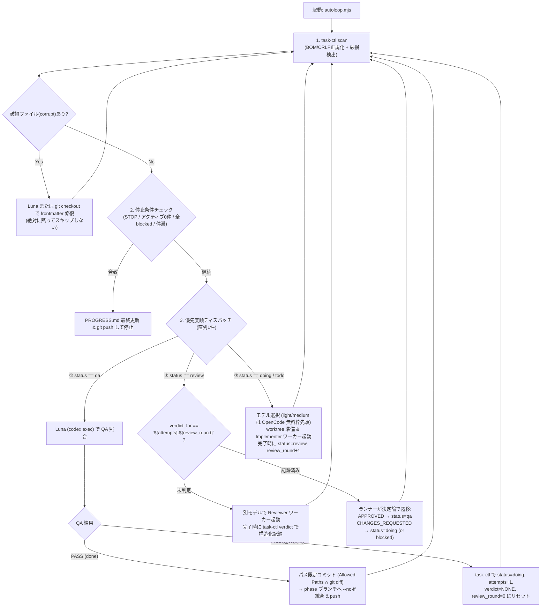

# 自律完結型開発システムの設計提案レポート（第1・第2ラウンド統合設計書）

- **作成・更新日**: 2026-11-13
- **対象ブリーフ**:
  - 第1ラウンド: [`docs/plans/DESIGN-CONSULT-BRIEF.md`](../plans/DESIGN-CONSULT-BRIEF.md)
  - 第2ラウンド（穴詰め・詳細仕様）: [`docs/plans/DESIGN-CONSULT-FOLLOWUP.md`](../plans/DESIGN-CONSULT-FOLLOWUP.md)
- **設計目標**: **「技術的には自立完結し、最終的な満足度だけはユーザーが判断する開発システム」**

---

## 0. 設計の核心（なぜこれまでの方式は詰まったのか）

[`DESIGN-CONSULT-BRIEF.md`](../plans/DESIGN-CONSULT-BRIEF.md) および [`DESIGN-CONSULT-FOLLOWUP.md`](../plans/DESIGN-CONSULT-FOLLOWUP.md) に記された実事故は、すべて **「誰がループの主導権を持ち、どの情報を決定論（コード）で扱い、どの情報を LLM で扱うか」** の境界設計に起因しています。

1. **機械パーサの脆さと「黙ってタスクが消える」事故**:
   - ワーカー（LLM）が編集した Markdown 本文（`## REVIEW` の見出し数や `## REPORT` のファイル一覧）を正規表現でパースして「レビュー済みか」「何をコミットするか」を判定すると、表記ゆれ・BOM・CRLF・古い判定の残留によって**「再レビューが永久に起動しない」「別タスクの成果物を巻き込んでコミットする」「タスク自体が一覧から消える」**事故が起きます。
   - **原則**: **Markdown 本文の正規表現パースによる制御を全廃する。** 制御に必要なすべての状態（レビュー判定、対象ラウンド、許可パス）は frontmatter の構造化スカラー値で持ち、仮に frontmatter が壊れても「黙ってスキップ」せず **`corrupt`（破損状態）として強制可視化・自動修復** する。
2. **Codex 単体 goal ループのトークン肥大とポーリング待ち時間**:
   - Codex（`gpt-6-luna`）は「QA 照合と例外判断」だけに使い、定型のモデル選択・ワーカー起動・コミットは薄型ランナー（Node.js スクリプト）が**プロセス終了駆動（待ち時間0秒）**で回すことで、トークン消費最小化と高速遷移を両立します。

---

## 1. 推奨構成と駆動の全体像

### 結論：「外部薄型ランナー（イベント駆動） ＋ `task-ctl`（構造化台帳 CLI） ＋ ステートレス `codex exec`（Luna QA/司令塔） ＋ 同期 CLI ワーカー（OpenCode 無料枠優先 / `agy`）」



---

## 2. 第2ラウンドで指摘された「4つの穴＋1点」の確定仕様（前回提案からの差分）

前回提案の曖昧だった部分を排除し、**データ構造・コマンド仕様・判定アルゴリズム**として確定させた仕様です。

---

### 【穴1の解決仕様】レビュー判定の読み手と「古い APPROVED 誤認」の完全防止

- **前回提案からの差分**:
  - **廃止**: `dispatch.ts` の `reviewVerdictPresent()` のような「`## REVIEW` 本文と `## QA Return` 見出しの出現回数を正規表現で数えて比較する」方式を**完全廃止**します。
  - **新規導入**: frontmatter に **`review_round`** / **`verdict`** / **`verdict_for`** の3フィールドを導入し、**判定の確定と状態遷移は 100% ランナー（決定論）** が行います。

#### 1. データ構造（Frontmatter のバージョントークン紐付け）
各タスクの試行とレビュー周回を一意に識別する複合トークン **`<attempts>.<review_round>`**（例: `1.1`, `1.2`, `2.1`）を導入します。

- `attempts`: 現在の実装試行回数（`1`〜`3`）
- `review_round`: 現在の `attempts` 内でのレビュー周回数（`0`〜`2`。未レビュー時は `0`、実装完了で `review` に入るたび `+1`）
- `verdict`: `NONE` | `APPROVED` | `CHANGES_REQUESTED` | `BLOCKED`
- `verdict_for`: その `verdict` が記録された時点の `<attempts>.<review_round>`（例: `1.1`）。未記録時は `-`。

#### 2. なぜこれで「QA 差し戻し後の古い APPROVED 誤認」が起きないのか（状態遷移トレース）
1. **初回実装完了時（Implementer → Review）**:
   - `attempts: 1`, `review_round: 1`, `status: review`, `verdict: NONE`, `verdict_for: -`
2. **初回レビュー完了時（Reviewer がコマンド実行）**:
   - レビュアーは最後に必ず以下のコマンドを実行する（プロンプトで強制）：
     ```bash
     node scripts/task-ctl.mjs verdict T-PH2-001 --verdict APPROVED
     ```
   - `task-ctl` は現在の `attempts` (`1`) と `review_round` (`1`) を読み、`verdict: APPROVED`, **`verdict_for: 1.1`** を書き込む。
3. **ランナーによる決定論的遷移**:
   - ランナーは `status === "review"` のタスクについて、**`verdict_for === "${attempts}.${review_round}"`**（つまり `1.1 === 1.1`）が成立しているときだけ `verdict` を有効とみなす。
   - `verdict === "APPROVED"` なので、ランナーが機械的に `status: qa` へ遷移させる。
4. **QA 差し戻し発生時（QA → Doing → 再 Review）**:
   - Luna（または `task-ctl qa-fail`）が差し戻す際、`attempts` を `1 → 2` に増やし、`review_round: 0`, `verdict: NONE`, `verdict_for: -` にリセットする。
   - **万が一リセット漏れで `verdict: APPROVED`, `verdict_for: 1.1` が残っていたとしても**、Attempt 2 の実装が終わって再レビューに入った時点の要求トークンは **`2.1`** であるため、`verdict_for ("1.1") !== "2.1"` となり、**古い `APPROVED` は 100% 機械的に無効（未レビュー）と判定される**。

#### 3. レビュアーが `verdict` 記録を忘れた／失敗したときの検出とフォールバック
レビュアープロセスが終了した直後、ランナーは `verdict_for === "${attempts}.${review_round}"` かどうかをチェックします。不一致（記録忘れ）の場合、以下の **2段階フォールバック** を実行します：
1. **Stage 1（構造化最終行からの自動救済）**:
   - レビュアーが `task-ctl` を叩き忘れたが、`## REVIEW` セクションの**末尾10行以内**に新しい `Verdict: APPROVED` または `Verdict: CHANGES_REQUESTED` を書いていた場合（かつ起動前のファイルハッシュから `## REVIEW` セクションが更新されている場合）、ランナーがその値を吸い上げて `verdict` と `verdict_for` を補完する。
2. **Stage 2（別モデルへの自動再ディスパッチ）**:
   - ファイル自体が未更新、または末尾からも判定が読めない場合は「レビュアーの不発（No-op）」とみなし、**タスクの `attempts` も `review_round` も消費せず**、そのレビュアーモデルに短期 cooldown（30分）を付けて、`MODEL_ROTATION` の次の別モデルで即座にレビューを再実行する（最大2回まで。それでも失敗したら Luna を呼ぶ）。

#### 4. 判定確定の責務分担（ランナー vs Luna）
- **ランナー（決定論）に寄せるもの**:
  - `verdict`（`APPROVED` / `CHANGES_REQUESTED`）に基づく `review → qa` または `review → doing`（`review_round >= 2` なら `attempts + 1`、それも上限なら `blocked`）の遷移すべて。ここに LLM（Luna）を介在させないことで、Luna の呼び出し回数を半分に減らし、判断ブレをなくします。
- **Luna（LLM）に寄せるもの**:
  - `status: qa` に到達した後の**最終 QA 照合**（受入条件・テスト実行コマンドの妥当性・禁止パスチェック）と、`status: blocked` 時のエスカレーション整理のみ。

---

### 【穴2の解決仕様】パス限定コミットと worktree → phase ブランチ統合手順

- **前回提案からの差分**:
  - **廃止**: `git add -A` を**全面禁止**。また、ワーカーが自由記述した `## REPORT` の `Changed Files` 欄をパースしてコミット対象を決める方式（現行 `dispatch.ts` の `parseChangedFiles`）も、書き漏れ・タイポ・無関係パスの混入リスクがあるため**主判定から外します**。
  - **新規導入**: タスク定義時に設定した **`allowed_paths`（許可パス prefixes）と実際の `git status --porcelain` の積集合（Intersection）** によって決定論的にコミット対象を決定し、**「タスク専用 git worktree ＋ 成果物と台帳の2段階分離コミット」** で統合します。

#### 1. コミットに含めるパスの決定アルゴリズム（決定論）
タスクファイルの frontmatter に `allowed_paths`（カンマ区切りのパスまたは prefix、例: `frontend/src/Delegations.tsx, frontend/src/Delegations.test.tsx, frontend/src/App.tsx, frontend/src/App.test.tsx`）を持たせます。

タスク実行・QA 時、ランナーは以下の集合計算を行います：
1. 作業ツリー（worktree）の `git status --porcelain -uall` から変更・新規・削除ファイル一覧 $D_{\text{actual}}$ を取得する。
2. $D_{\text{actual}}$ から当該タスクの進捗ファイル自身 $P_{\text{task}}$（`progress/<phase>/tasks/<ID>.md`）を除いた集合を $D_{\text{code}}$ とする。
3. 各ファイル $f \in D_{\text{code}}$ を以下の3つに分類する：
   - **禁止パス違反 ($D_{\text{forbidden}}$)**: `.pi/extensions/`, `docs/planning/`, `docs/plans/`, `loop_engine/`, `.loop/` にマッチするもの。
   - **許可パス内 ($D_{\text{allowed}}$)**: タスクの `allowed_paths` のいずれかに完全一致またはディレクトリ前方一致するもの。
   - **スコープ外変更 ($D_{\text{unmapped}}$)**: $D_{\text{code}} \setminus (D_{\text{allowed}} \cup D_{\text{forbidden}})$（ワーカーが無断で触った別ファイルやゴミファイル）。
4. **ゲート判定**:
   - $D_{\text{forbidden}} \neq \emptyset$ または $D_{\text{unmapped}} \neq \emptyset$ の場合：**コミットを拒否**し、該当ファイル名をエラーメッセージに明記して QA FAIL（`status: doing` へ差し戻し、または禁止パスのみなら `git checkout --` で自動復元）とする。
   - $D_{\text{forbidden}} = \emptyset$ かつ $D_{\text{unmapped}} = \emptyset$ かつ $D_{\text{allowed}} \neq \emptyset$ の場合のみ：**`git add -- <D_allowed の各パス>`** で明示的にパス指定ステージングを行う。

#### 2. 台帳ファイル（`tasks/<ID>.md`・`PROGRESS.md`）は同一コミットか、別コミットか？
**結論：「① コード成果物コミット（worktree 側）」と「② 台帳更新コミット（phase ブランチ統合後）」の2コミットに明確に分離します。**

- **分離する理由**:
  1. **バグ切り分けと `git revert` の容易さ**: もしタスク `T-PH2-001` のコード変更が後続タスクや CI を壊した場合、コードコミットだけを `git revert` したくなります。同一コミットに台帳（`T-PH2-001.md` や `PROGRESS.md`）が混ざっていると、revert した瞬間に台帳まで巻き戻ってしまい、ハーネスが「まだ終わっていない」と誤認して再実行暴走を起こします。
  2. **worktree 間のコンフリクト防止**: `PROGRESS.md` は全タスク共通のファイルです。各タスクの worktree 内で `PROGRESS.md` をコミットさせると、マージ時に毎回コンフリクトします。

#### 3. worktree → `phase/<slug>` ブランチへの統合手順（コマンドレベルの具体手順）
1. **タスク開始時（`doing` 遷移時）**:
   - メインリポジトリは `phase/<slug>` ブランチにチェックアウトしておく。
   - タスク専用の worktree を `.pi/worktrees/<TASK-ID>`（ブランチ名 `task/<TASK-ID>`、起点 `phase/<slug>`）に作成する：
     ```bash
     git worktree add -B task/T-PH2-001 .pi/worktrees/T-PH2-001 phase/2-authz
     ```
   - Implementer と Reviewer は **`cwd: .pi/worktrees/T-PH2-001`** の中で作業する（メインツリーを一切汚さない）。
2. **QA 合格（`done`）時の統合4ステップ**:
   - **Step A（worktree 内でコード成果物のみをパス限定コミット）**:
     ```bash
     git -C .pi/worktrees/T-PH2-001 add -- <D_allowed...>
     git -C .pi/worktrees/T-PH2-001 commit -m "feat(phase-2-authz): implement T-PH2-001" -- <D_allowed...>
     ```
   - **Step B（worktree 内の更新済み `T-PH2-001.md` をメインツリーへコピーし、worktree をクリーンにして閉じる）**:
     - `T-PH2-001.md` をメインツリーの `progress/phase-2-authz/tasks/T-PH2-001.md` にコピー。
     - `git -C .pi/worktrees/T-PH2-001 checkout -- progress/` で worktree 内の台帳差分を消去。
   - **Step C（メインツリーの `phase/<slug>` ブランチへ `--no-ff` マージ）**:
     ```bash
     git checkout phase/2-authz
     git merge --no-ff -m "Merge task/T-PH2-001 into phase/2-authz" task/T-PH2-001
     ```
   - **Step D（メインツリー側で台帳 `T-PH2-001.md` と `PROGRESS.md` をパス限定コミット & Push & worktree 削除）**:
     ```bash
     git add -- progress/phase-2-authz/tasks/T-PH2-001.md progress/phase-2-authz/PROGRESS.md
     git commit -m "docs(progress): mark T-PH2-001 done" -- progress/phase-2-authz/tasks/T-PH2-001.md progress/phase-2-authz/PROGRESS.md
     git push -u origin phase/2-authz
     git worktree remove --force .pi/worktrees/T-PH2-001
     ```

---

### 【穴3の解決仕様】重み別タイムアウト設計と、タイムアウト kill 時の `attempts`・未完了変更の扱い

- **前回提案からの差分**:
  - **廃止**: 一律15分タイムアウトを廃止します（ご指摘の通り、`agy` の heavy タスクでは30分級の実行があり、現行 `config.ts` でも `--print-timeout 30m` / `processTimeoutMs: 35m` が使われています）。
  - **新規導入**: 重み（`light` / `medium` / `heavy`）とステージ（`implement` / `review` / `qa`）に応じた段階的タイムアウトと、**「タイムアウト時の git worktree 自動チェックポイント保存」** を導入します。

#### 1. 重み別・ステージ別のタイムアウト設計表

| 重み (`weight`) | 実装 (`implement`) | レビュー (`review`) | QA (`Luna`) | `agy --print-timeout` 渡し値 | 根拠 |
|---|---|---|---|---|---|
| **`light`** | **15分** (`900,000 ms`) | **10分** (`600,000 ms`) | **5分** | `12m` | 1〜2ファイルの軽微な修正・テスト追加。15分を超える場合は対話待ちハングの可能性が高い。 |
| **`medium`** | **30分** (`1,800,000 ms`) | **15分** (`900,000 ms`) | **8分** | `25m` | 複数ファイル（UI＋テスト等）の標準実装。Vitest / pytest の実行時間を含め30分確保。 |
| **`heavy`** | **45分** (`2,700,000 ms`) | **20分** (`1,200,000 ms`) | **10分** | `40m` | 認可・アーキテクチャ変更など深い推論と複数回のテスト修正を伴う重い作業。 |

※ プロセスの強制終了（`taskkill /F /T /PID <pid>`）は、`agy --print-timeout` が自発的に終了する猶予として **`--print-timeout` ＋ 5分** に設定します。

#### 2. タイムアウトで kill した場合、`attempts` は消費するか？
**結論：「作業ツリーに有効な変更（進捗）があったかどうか」で機械的に分岐します。**

- **ケース A：変更ゼロでタイムアウトした場合（ハング / API 無応答 / 思考ストール）**:
  - `D_allowed` に1バイトも変更がないままタイムアウトした場合は、ワーカー CLI 側の通信ストールまたは無限ループであるため、**`attempts` は消費しない（据え置き）**。
  - 当該モデルに **60分の cooldown（reason: `timeout_stalled`）** を付与し、即座にローテーション表の次候補モデルへ切り替える。
- **ケース B：許可パス内のコード変更（作業途中）がある状態でタイムアウトした場合**:
  - ワーカーが実装を進めていたが時間切れになったケース。この場合は **`attempts` を `+1` 消費する**（ただし上限3回までは継続可能）。

#### 3. worktree に残った未完了の変更は保持するか、捨てるか？
**結論：「許可パス内の変更（$D_{\text{allowed}}$）は WIP チェックポイントとして保持し、スコープ外・禁止パスのゴミだけを捨てて再開に使う」。**

- 30分〜45分かけて8割まで書き上げたコードとテストを `git reset --hard` で全部捨ててゼロから書き直させるのは、トークンと時間の最大の浪費です。
- **具体的な処理手順（Timeout Handler）**:
  1. `taskkill /F /T /PID <pid>` でワーカープロセスツリーを確実に停止する。
  2. worktree 内で `D_forbidden` と `D_unmapped`（許可パス外のファイル）だけを `git checkout --` / `git clean -f` で破棄する。
  3. `D_allowed`（許可パス内の変更）が残っていれば、そのまま worktree 上に保持し、タスクファイルの `## REPORT` 末尾にランナーが以下の自動メモを追記する：
     ```markdown
     - **[Runner System Note]**: Previous worker (`<runner>/<model>`) timed out after <X>m with uncommitted progress in: `<files...>`. Next worker should inspect `git diff`, verify existing changes, run the scoped tests, and complete the remaining requirements.
     ```
  4. これにより、次に起動するワーカー（または同モデルの次試行）は `git diff` を見て残り2割の仕上げとテスト実行・`REPORT` 記入を行うだけで済み、数分で完了できます。
  5. ただし、**次の試行でも連続してタイムアウトした場合（2回連続タイムアウト）** は、「中途半端な変更が足を引っ張っている」と判断し、その時点で `git reset --hard phase/<slug>` で worktree をクリーンに戻します。

---

### 【穴4の解決仕様】`task-ctl` の厳密な frontmatter パース仕様と、破損時の「絶対に黙って消えない」フェイルセーフ

- **前回提案からの差分**:
  - `task-ctl` が受け付ける文法仕様を厳密に定義し、さらに **「ディレクトリ内の物理ファイル一覧（`fs.readdirSync`）とパース結果の 1対1 照合」** を必須化します。

#### 1. `task-ctl` が許容する frontmatter の厳密な仕様（Grammar Specification）
`progress/<phase>/tasks/*.md` の frontmatter パーサ（およびシリアライザ）は以下の仕様で動作します：

1. **エンコーディング・BOM・改行コード**:
   - 読み込み時に先頭バイトを検査し、UTF-16LE BOM (`0xFF 0xFE`)、UTF-16BE BOM (`0xFE 0xFF`)、UTF-8 BOM (`0xEF 0xBB 0xBF`) があればすべて自動デコード＆除去し、改行コード `\r\n` および `\r` をすべて `\n` に変換してから解析する。
2. **境界（フェンス）**:
   - ファイル先頭から5行以内に現れる最初の `^---\s*$` の行を開始フェンスとし、その次以降に現れる最初の `^---\s*$`（または `^\.\.\.\s*$`）を終了フェンスとする。
3. **行フォーマットとキー・値の許容範囲**:
   - **空行・コメント行**: フェンス内の空行（`^\s*$`）および `#` で始まるコメント行（`^\s*#`）はエラーにせず無視する。
   - **キー名**: `^\s*([A-Za-z0-9_-]+)\s*:\s*(.*)$` にマッチさせ、キー名は **小文字（lowercase）に正規化** する（ワーカーが `Status: review` と大文字で書いても `status` として救済する）。
   - **キーの順序**: **順不同を許容**する（書き出し時は `task-ctl` が正規の順序で整列させる）。
   - **値の前後空白とクォート**: 値の前後の空白・タブを trim し、両端が対応するシングルクォート `'...'`、ダブルクォート `"..."`、またはバッククォート `` `...` `` で囲まれている場合は外側のクォートを剥がす（ワーカーが `status: "review"` や ``status: `review` `` と書いても `review` として救済する）。
   - **インラインコメント**: 値がクォートされていない場合、末尾の `\s+#.*$` はコメントとして除去する。
   - **重複キー**: 同一フェンス内で同じキーが複数回出現した場合は、**後勝ち（Last-wins）** としつつ、警告フラグ `warnings: ["duplicate_key:<key>"]` を記録する。
   - **未知キー**: 必須キー以外の未知のキーがあってもエラーにせず、`extra` マップにそのまま保持して書き戻し時も消さない。
4. **スキーマ検証（必須キーと語彙チェック）**:
   - `id`: 非空文字列（欠落時はファイル名 `<STEM>.md` から `<STEM>` を自動補完する！）
   - `status`: `todo` | `doing` | `review` | `qa` | `done` | `blocked` の6語彙のみ有効（大文字小文字は小文字化して救済。それ以外の語彙や欠落は **`corrupt`** と判定）。

#### 2. Frontmatter が壊れていた場合のランナーの振る舞い（「黙って消える」を物理的にゼロにする仕組み）
現行の `dispatch.ts`（156行目）には以下の致命的な1行があります：
```ts
if (!fm.id || !fm.status) continue; // ← これが「壊れたファイルが黙って消える」真犯人！
```
この `continue` による無言スキップを **禁止** し、以下の3段階の仕組みで対処します。

1. **物理ファイル全件列挙による `corrupt` 強制検出**:
   - `task-ctl list <phase> --json` は、`progress/<phase>/tasks/` ディレクトリ内のすべての `.md` ファイルを `fs.readdirSync` で物理列挙する。
   - パース結果で `status` が欠落している、フェンス `---` が閉じられていない、または6語彙以外の不正値が入っているファイルは、配列から除外するのではなく、**`status: "corrupt"`**（および `error: "invalid_frontmatter: ..."`）というオブジェクトとして**必ず結果配列に含める**。
2. **Git 直前コミットからの自動自己修復（Self-Healing Frontmatter）**:
   - ランナーが `status: "corrupt"` のファイルを検出した場合、ワーカーが本文編集中に誤って先頭の `---` を消したケースが大半である。
   - ランナーはまず **`git show HEAD:<task-file>`** から「直前の正常な frontmatter」を取り出し、現在のファイルの本文（`# Task ...` 以降）と結合して復元を試みる。
3. **人間と Luna への強制可視化（アラート昇格）**:
   - 自動修復でも直らない場合（新規ファイルで `HEAD` に履歴がない等）、ランナーはそのタスクを無言で飛ばさず、`PROGRESS.md` のタスク一覧表の Status 列を **`🚨 CORRUPT (要確認)`** に書き換え、Section 4（エスカレーション事項）にファイルパスと先頭10行のダンプを出力して **即座に `git commit & push`** する。これにより、ユーザーの唯一の窓である GitHub 上で「どのタスクファイルが壊れたか」が100%可視化される。

---

### 【追加論点の解決仕様】モデルローテーションの実態改善（OpenCode 無料プールの第一候補化）と Cooldown キー設計

- **現状の課題**:
  - 現行の [`docs/agent/MODEL_ROTATION.md`](../agent/MODEL_ROTATION.md) および `.pi/extensions/harness/rotation.ts` では、`heavy` / `medium` / `light` のすべてで `agy`（Google AI Pro 枠）が候補列の先頭（1番目・2番目）に置かれており、OpenCode 無料モデル（12種）は「`agy` の `gemini` プールと `claude-gpt` プールの両方が 5時間枠上限に達して初めて呼ばれる第3候補」になっています。これでは `agy` の有料枠を真っ先に食い潰し、OpenCode 無料枠が全く活用されません。

#### 1. ローテーション表自体の改訂か、ランナー側の選択ロジックか？
**結論：「① `MODEL_ROTATION.md`（規約）と `rotation.ts`（コード）の両方を改訂」し、さらに「② ステージ別（実装 vs レビュー）× 試行回数（初回 vs リトライ）のハイブリッド選択ロジック」を導入します。**

規約文書（`MODEL_ROTATION.md`）とランナーの実装が食い違うと、Luna（プロンプトで `MODEL_ROTATION.md` を読む）とランナーの判断が分裂するため、**両方とも以下の「Free-First（無料枠優先）＋ 失敗時エスカレーション」構成に統一**します。

#### 2. 改訂後の重み別・ステージ別モデル配分表

| 重み (`weight`) | ステージ / 条件 | 第1候補（最優先） | 第2候補（枠切れ or 1回目失敗時） | 第3候補（最終砦） | 設計意図 |
|---|---|---|---|---|---|
| **`light`** | **実装 (`implement`)** | **`opencode`: 無料プール Tier-A/B**（カーソル巡回） | `agy`: `Gemini 3.8 Flash` | `agy`: `GPT-OSS 120B` → `ollama/gemma3:4b` | 定型作業・テスト追加は **100% 無料モデルから開始**し、`agy` 枠を温存する。 |
| **`light`** | **レビュー (`review`)** | **`opencode`: 無料プール**（実装モデルと別 slug） | `agy`: `GPT-OSS 120B` | `agy`: `Gemini 3.8 Flash` | 無料モデル同士の相互レビュー（別モデル保証）でコストゼロ完結。 |
| **`medium`** | **実装 (`implement` / `attempts == 1`)** | **`opencode`: 無料プール Tier-A（主力コードモデル群）** | `agy`: `Gemini 4 Argon` (Medium) | `agy`: `Claude Sonnet 5.5` | **初回試行（Attempt 1）は必ず OpenCode 無料プール（`glm-5.3-flash-free`, `deepseek-v4.1-flash-free`, `minimax-m3.1-flash-free` 等）に挑ませる。** |
| **`medium`** | **実装（`attempts >= 2`：差し戻し・リトライ時）** | **`agy`: `Gemini 4 Argon` (Medium)** | `agy`: `Claude Sonnet 5.5` | `opencode`: 無料プール（別モデル） | 無料モデルで1回失敗（レビュー/QA差し戻し）したタスクだけ、上位の `agy` 枠へ自動昇格（Escalation）させる。 |
| **`medium`** | **レビュー (`review`)** | **`agy`: `Claude Sonnet 5.5`** または **`agy`: `Gemini 3.8 Flash`**（実装が `opencode` の場合） | `opencode`: 無料プール Tier-A（実装モデルと別 slug） | `agy`: `Gemini 4 Argon` | 実装を無料モデルに任せる分、レビューには別系統のモデルを当てて品質を担保する。 |
| **`heavy`** | **実装 / レビュー** | **`agy`: `Gemini 4 Argon` (High)** | **`agy`: `Claude Opus 5.5`** | `agy`: `Claude Sonnet 5.5` | 難度の高い設計・認可変更だけは最初から最強モデルを投入する。 |

> **OpenCode 無料プール（12種）の2階層化（Tier-A / Tier-B）**:
> 12種を一律に回すのではなく、コーディング・ツール呼び出し能力が高い主力群（**Tier-A**: `opencode/glm-5.3-flash-free`, `opencode/deepseek-v4.1-flash-free`, `opencode/minimax-m3.1-flash-free`, `opencode/mimo-v2.6-flash-free`, `opencode/qwen` / `beam-free`, `big-pickle`）を `medium` 実装に優先割り当てし、残りの軽量群（**Tier-B**）も含めた全12種を `light` で巡回させます。さらに `PROGRESS.md` の QA 通過率が集計されるにつれ、通過率の低いモデルを後回しにできます。

#### 3. Cooldown 状態の持ち方（キー設計とデータ構造）
OpenCode 無料モデルと `agy` では「枠の単位」が異なるため、`.pi/harness/state.json` の `cooldowns` キー設計を以下の **3階層スコープ** に明確化します：

```json
{
  "cooldowns": [
    {
      "key": "pool:agy:gemini",
      "until": "2026-11-13T23:30:00.000Z",
      "reason": "quota_exhausted (Resets in 4h 30m)"
    },
    {
      "key": "model:opencode/glm-5.3-flash-free",
      "until": "2026-11-13T19:15:00.000Z",
      "reason": "rate_limit_429 (15m cooldown)"
    },
    {
      "key": "provider:opencode:free-api",
      "until": "2026-11-13T19:05:00.000Z",
      "reason": "provider_429_burst (5m backoff)"
    }
  ],
  "freeCursor": 4
}
```

- **キー体系と持続時間（TTL）の使い分け**:
  1. **`pool:agy:gemini` / `pool:agy:claude-gpt`**:
     - `agy` はモデル個別ではなく2つのプール単位で5時間枠を共有するため、`Gemini 4 Argon` で枠切れが出たら `pool:agy:gemini` に `Resets in ...`（不明なら5時間）の cooldown を設定し、同プールの `Gemini 3.8 Flash` も連動して除外する。
  2. **`model:opencode/<slug>`（個別モデル単位）**:
     - OpenCode 無料モデルはモデルごとにバックエンドやレート制限が異なる。特定の無料モデル（例: `opencode/iceman-free`）が 429 や無応答を起こした場合は、**`pool:free` 全体を止めるのではなく `model:opencode/iceman-free` 単体に 15分〜30分の cooldown** を付け、`freeCursor` を `+1` 進めて即座に次の無料モデル（例: `opencode/glm-5.3-flash-free`）を試す。
     - ※ 現行 `rotation.ts` でもし `pool: "free"` 全体に5時間 cooldown を付けてしまうと、1つの無料モデルの 429 で12種すべてが5時間使えなくなるため、**OpenCode 無料モデルは必ず `model:<slug>` 個別キーで cooldown 管理する**のが極めて重要です。
  3. **`provider:opencode:free-api`（エンドポイント全体の一時バックオフ）**:
     - もし3つ連続で異なる OpenCode 無料モデルが即座に 429 を返した場合は、OpenCode 側のアカウント/IP レベルの短期レート制限と判定し、`provider:opencode:free-api` に **5分間の短期 cooldown** を設定して、その間だけ `agy` にフェイルオーバーする。

---

## 3. 新たに必要になるデータ項目一覧

本設計により、タスクファイルの frontmatter および `.pi/harness/state.json` に追加・標準化するフィールドの一覧です。

### 3.1 タスクファイル（`progress/<phase>/tasks/<TASK-ID>.md`）の Frontmatter 全フィールド

```yaml
---
id: T-PH2-001
phase: phase-2-authz
status: doing
weight: medium
assignee: opencode
model: opencode/glm-5.3-flash-free
reviewer: agy/Claude Sonnet 5.5
attempts: 1
review_round: 0
verdict: NONE
verdict_for: -
allowed_paths: frontend/src/Delegations.tsx, frontend/src/Delegations.test.tsx, frontend/src/App.tsx, frontend/src/App.test.tsx
updated: 2026-11-13T19:00:00+09:00
---
```

| フィールド名 | 新規/既存 | 型・許容値 | 役割・更新タイミング |
|---|---|---|---|
| `id` | 既存 | 文字列 (`T-PH2-001`) | タスク ID（欠落時はファイル名から自動補完） |
| `phase` | 既存 | 文字列 (`phase-2-authz`) | 所属 Phase ディレクトリ名 |
| `status` | 既存 | `todo` \| `doing` \| `review` \| `qa` \| `done` \| `blocked` | タスクの現在状態（破損時はランナー内部で `corrupt` として扱う） |
| `weight` | 既存 | `light` \| `medium` \| `heavy` | ローテーション候補列とタイムアウト値（15m / 30m / 45m）の決定キー |
| `assignee` | 既存 | `opencode` \| `agy` \| `ollama` \| 空 | 現在の実装ワーカー実行系 |
| `model` | 既存 | モデル名 / slug \| 空 | 現在の実装ワーカーモデル |
| `reviewer` | 既存 | `<runner>/<model>` \| 空 | レビュー担当モデル（`model` とは必ず別モデル） |
| `attempts` | 既存 | 整数 `0`〜`3` | 実装試行回数（枠切れ・無変更ストール時は消費しない） |
| **`review_round`** | **★新規** | 整数 `0`〜`2` | 現在の `attempts` 内でのレビュー周回数。`doing → review` 遷移時に `+1`、QA 差し戻し（`attempts + 1`）時に `0` にリセット |
| **`verdict`** | **★新規** | `NONE` \| `APPROVED` \| `CHANGES_REQUESTED` \| `BLOCKED` | レビュアーが `task-ctl verdict` で記録する構造化判定 |
| **`verdict_for`** | **★新規** | `<attempts>.<review_round>`（例: `1.1`）\| `-` | その `verdict` がどの試行・どのレビュー周回に対するものかを示すバージョントークン。**古い `APPROVED` の誤認を100%防ぐ** |
| **`allowed_paths`** | **★新規** | カンマ区切りパス一覧 | このタスクで変更・コミットを許可するファイル/ディレクトリ prefix。コミット時はこれと `git status` の積集合のみをステージングする |
| `updated` | 既存 | ISO 8601 日時文字列 | `task-ctl` が更新時に自動セット |

---

## 4. 更新版：最小構成（MVP）の実装手順（Step 1〜4）

第2ラウンドで詰めた全仕様を反映した、無駄のない4ステップの実装手順です。既存の `.pi/extensions/harness/` のモジュール資産を活かしつつ、ポーリング依存と正規表現パースの穴を塞ぎます。

### Step 1: 構造化台帳＆フロントマター保護 CLI `scripts/task-ctl.mjs` の作成（約120行）
すべてのファイル読み書きと正規化を一手に引き受ける CLI を作ります。
- **`scan <phase> --json`**:
  - `progress/<phase>/tasks/*.md` を物理列挙し、BOM（UTF-8/UTF-16LE）除去・CRLF→LF 正規化・キー小文字化・クォート除去を行って JSON 配列を返す。
  - パース不能または `status` 不正のファイルは黙って捨てず、`status: "corrupt"` として返し、可能なら `git show HEAD:<file>` から frontmatter を自動修復する。
- **`transition <task-file> --to <status>`**:
  - `to=doing`: `attempts` の管理、モデル割当の記録。
  - `to=review`: `review_round` を `+1` し、`verdict: NONE`, `verdict_for: -` をセット。
  - `to=qa-fail`: `attempts` を `+1` し、`status: doing`, `review_round: 0`, `verdict: NONE`, `verdict_for: -` にリセット。
- **`verdict <task-file> --verdict <APPROVED|CHANGES_REQUESTED>`**:
  - レビュアーが実行するコマンド。現在の `attempts` と `review_round` から `verdict_for: "${attempts}.${review_round}"` を自動刻印する。

### Step 2: Free-First ローテーション＆重み別タイムアウト付きワーカー実行器 `scripts/run-worker.mjs` の作成（約100行）
- **モデル選択 (`pickModel`)**:
  - `light`（全試行）および `medium`（`attempts === 1` の実装）では **OpenCode 無料プール（`opencode/*-free`）を第1候補** として選択する。
  - 429 / Quota 発生時は、OpenCode なら `model:opencode/<slug>` 単体に 20分 cooldown、`agy` なら `pool:agy:<pool>` にリセット時刻までの cooldown を記録し、`attempts` を消費せずに即座に次候補へ切り替える。
- **重み別タイムアウトと WIP 保護**:
  - `light: 15m` / `medium: 30m` / `heavy: 45m` のタイマーを張り、超過時は `taskkill /F /T /PID` で停止。
  - 許可パス内の変更が 0件なら `attempts` 据え置きで別モデルへ切替、変更があれば WIP を保持したまま `REPORT` に引き継ぎメモを追記する。

### Step 3: パス限定コミット＆ worktree 統合ループ `scripts/autoloop.mjs` の作成（約150行）
30分タイマーを撤廃し、1タスクずつ直列・イベント駆動で最後まで回し切るメインループです。
1. **毎サイクル冒頭**: `task-ctl scan` を実行。`corrupt` があれば修復または `PROGRESS.md` にアラートコミットして push。
2. **停止条件の決定論チェック**:
   - `.pi/harness/STOP` 存在、またはアクティブタスク（`todo`/`doing`/`review`/`qa`）が 0件、または全件 `blocked`、または3サイクル連続状態不変ならループを終了。
3. **直列バトン実行（待ち時間 0秒）**:
   - **`doing` / `todo`**: `.pi/worktrees/<ID>`（ブランチ `task/<ID>`）を用意し、`run-worker.mjs` で実装ワーカーを実行 → 終了したら `task-ctl transition --to review`。
   - **`review`**: `verdict_for !== "${attempts}.${review_round}"` なら別モデルでレビュアーを実行（記録漏れ時は末尾10行フォールバック）。記録済みならランナーが決定論で `APPROVED → qa` / `CHANGES_REQUESTED → doing` へ遷移。
   - **`qa`**: `codex exec --model gpt-6-luna` を起動して QA 照合。
   - **`done`（コミット＆統合）**:
     1. worktree 内で $D_{\text{actual}} \cap \text{AllowedPaths}$ だけを `git add -- <paths...>` してコードコミット（禁止パスやスコープ外変更があれば拒否）。
     2. `phase/<slug>` ブランチへ `git merge --no-ff task/<ID>`。
     3. メインツリー側で `progress/<phase>/tasks/<ID>.md` と `PROGRESS.md` だけを別コミットし、`git push origin phase/<slug>` を実行して worktree を削除。

### Step 4: プロンプト3ファイル（`implementer.md` / `reviewer.md` / `orchestrator.md`）への `task-ctl` 組み込みと `phase-2-authz` 実戦投入
- `.pi/harness/prompts/implementer.md` と `reviewer.md` の完了手順を「手で frontmatter を書き換える」から **`node scripts/task-ctl.mjs ...` を実行する** 指示にアップデートし、`progress/phase-2-authz/tasks/T-PH2-001.md`〜`003.md` の frontmatter に `review_round: 0`, `verdict: NONE`, `verdict_for: -`, `allowed_paths: ...` を追記します。
- その後 `node scripts/autoloop.mjs phase-2-authz` を起動すれば、OpenCode 無料モデルを主力として `T-PH2-001`〜`003` が直列・待ち時間ゼロで実装・レビュー・QA・パス限定コミット・push まで完走し、全タスク `done` で自動停止します。
